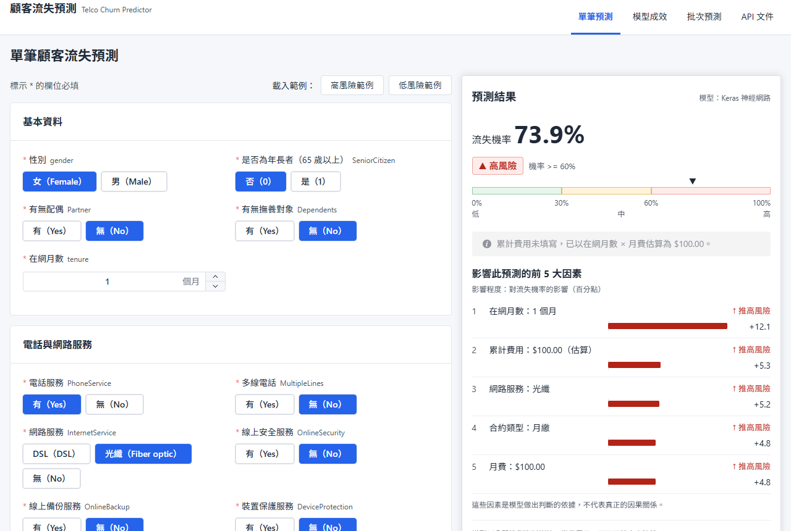
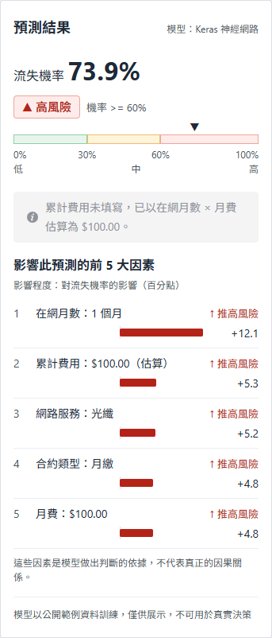
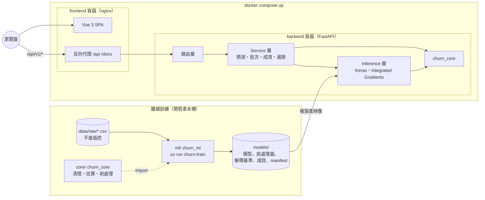

# Telco 顧客流失預測（Telco Churn Predictor）

輸入一位電信顧客的資料，預測他流失的機率與風險等級，並列出影響這次預測最大的 5 個因素。



<details>
<summary>手機版</summary>



</details>

> **English summary** — A full-stack churn prediction app built as a portfolio project.
> A Keras MLP (compared against a logistic-regression baseline) is trained on the public
> IBM Telco Customer Churn dataset and served by FastAPI, with per-prediction explanations
> via Integrated Gradients. The Vue 3 + TypeScript frontend uses types generated from the
> OpenAPI contract. Training and serving share one preprocessing package to avoid
> training–serving skew. Everything starts with a single `docker compose up --build`.

---

## 目錄

- [功能](#功能)
- [架構](#架構)
- [技術選型與理由](#技術選型與理由)
- [模型成效](#模型成效)
- [快速啟動](#快速啟動)
- [重新訓練模型](#重新訓練模型)
- [開發指令](#開發指令)
- [環境需求](#環境需求)
- [Commit 規範](#commit-規範)
- [已知限制](#已知限制)
- [專案文件](#專案文件)

## 功能

| 功能 | 說明 | 狀態 |
|---|---|---|
| 單筆預測 | 填寫 19 個欄位（或一鍵載入範例）→ 流失機率、低／中／高風險等級 | ✅ |
| 影響因素 | 前 5 大因素、推高或拉低風險、影響程度（百分點） | ✅ |
| 表單防呆 | 電話／網路服務連動鎖定、即時驗證、累計費用可留空由系統估算 | ✅ |
| 預測 API | 單筆、批次 CSV、成效指標，Swagger 文件 `/docs` | ✅ |
| 模型成效頁 | ROC 曲線、混淆矩陣、Keras 與邏輯迴歸比較 | 🚧 API 已完成，頁面未做 |
| 批次預測頁 | 上傳 CSV、下載結果 | 🚧 API 已完成，頁面未做 |

## 架構



```
core/       共用前處理套件 churn_core（訓練與推論都 import 這一份）
ml/         訓練管線 churn_ml：切分、訓練、調門檻、評估、匯出
models/     訓練產物（進版控，clone 後不需資料集即可啟動）
backend/    FastAPI：路由 → service → inference 三層，service 依賴介面可注入
frontend/   Vue 3 + TypeScript + Pinia + Element Plus
contracts/  OpenAPI 合約（前端型別由此產生，CI 會檢查是否過期）
docs/specs/ 需求、畫面設計、技術設計、任務清單、審核紀錄
```

## 技術選型與理由

| 選擇 | 理由 |
|---|---|
| **共用前處理套件 `churn_core`** | 訓練與 API 用同一份清理、估算、one-hot、標準化程式，前處理參數存成 JSON，避免 training–serving skew；有測試逐位元比對兩條路徑的特徵向量 |
| **Keras MLP＋邏輯迴歸基準** | 課程使用 TensorFlow／Keras；另訓練邏輯迴歸當基準，誠實比較神經網路是否真的比較好 |
| **門檻調整處理類別不平衡** | 流失只佔 26.5%；用驗證集調門檻讓 Recall ≥ 0.75，機率保持校準，30%／60% 的風險切點才有意義；加權訓練的版本也一起比較並記錄 |
| **Integrated Gradients** | 直接解釋畫面上那個 Keras 模型，用 `tf.GradientTape` 自行實作，不增加依賴，單筆約 10 ms 且結果固定 |
| **FastAPI** | Pydantic 嚴格驗證、內建 OpenAPI／Swagger，型別與文件同一來源 |
| **Vue 3＋Pinia＋Element Plus** | Composition API＋TypeScript strict；Element Plus 表單與表格元件成熟 |
| **openapi-typescript** | 前端型別由後端 OpenAPI 產生，前後端欄位不會各改各的 |
| **uv workspace** | 一份 `uv.lock` 鎖定 core／ml／backend 的所有版本，Docker 內外完全相同 |
| **不用資料庫** | 資料皆唯讀、預測不留存，資料庫只會增加維運成本 |

## 模型成效

測試集 1,409 筆（訓練時未使用），資料切分：訓練 4,507／驗證 1,127／測試 1,409，分層抽樣、固定種子。

| 模型 | ROC-AUC | Recall | Precision | F1 | 門檻 |
|---|---|---|---|---|---|
| **Keras MLP**（線上使用） | **0.837** | **0.754** | 0.516 | 0.613 | 0.34 |
| 邏輯迴歸（基準） | 0.843 | 0.765 | 0.521 | 0.620 | 0.29 |

- 邏輯迴歸的 AUC 比 Keras 高約 0.005，在設定的容許範圍（0.01）內。這份資料集上，簡單模型與神經網路表現接近是常見的結果，這裡如實呈現。
- 不調門檻（固定 0.5）時 Keras 的 Recall 只有 0.60；調到 0.34 後抓得到 75% 的流失顧客。
- 相同設定重新訓練兩次，AUC 完全相同；單次訓練約 40 秒（筆電 CPU）。
- 完整數字見 [`models/metrics.json`](models/metrics.json)。

## 快速啟動

只需要安裝 [Docker Desktop](https://www.docker.com/products/docker-desktop/)，不需要資料集（訓練好的模型已在 `models/`）。

```bash
docker compose up --build
```

開啟 http://localhost:8080 ，按「載入範例」再按「預測」。

- API 文件（Swagger）：http://localhost:8080/docs
- 健康檢查：http://localhost:8080/api/v1/health
- 首次 build 需下載 TensorFlow，約需數分鐘；映像大小約為 backend 3.5 GB、frontend 92 MB；build 完成後 `docker compose up` 到服務就緒約 10 秒。
- 連接埠可用環境變數調整：`FRONTEND_PORT`（預設 8080）、`BACKEND_PORT`（預設 8000）。其他設定見 [`.env.example`](.env.example)，複製成 `.env` 即可覆寫（非必要）。

## 重新訓練模型

1. 從 Kaggle 下載 [Telco Customer Churn](https://www.kaggle.com/datasets/blastchar/telco-customer-churn)，把 `WA_Fn-UseC_-Telco-Customer-Churn.csv` 放到 `data/raw/`（此檔不進版控）。
2. 用本機的 Python 3.14.8 建立專案專用環境（**不要用全域 `pip install`**，所有套件只裝在專案的 `.venv`）。下方是 Windows 的預設安裝路徑，請換成你本機 Python 3.14.8 的位置（Linux 例如 `/usr/bin/python3.14`）：

   ```bash
   uv venv --python "C:\Program Files\Python314\python.exe"
   ```

   ```bash
   uv sync --all-packages --frozen
   ```

3. 訓練並驗證：

   ```bash
   uv run churn-train
   ```

   ```bash
   uv run churn-verify --artifacts models
   ```

   `churn-verify` 會檢查檔案雜湊、成效門檻（AUC ≥ 0.82、Recall ≥ 0.70）與 Keras 是否不輸邏輯迴歸超過 0.01。

## 開發指令

```bash
uv run ruff check . && uv run ruff format --check . && uv run mypy core/src ml/src backend/src && uv run pytest -q
```

```bash
cd frontend && npm ci && npm run lint && npm run type-check && npm run test -- --run && npm run build
```

- 本機開發：`uv run uvicorn churn_api.main:app --reload`（後端 8000）＋ `cd frontend && npm run dev`（前端 5173，已代理 `/api`）。
- 後端 API 有改動時重新產生合約與前端型別：`uv run python backend/scripts/export_openapi.py`，再 `cd frontend && npm run gen:api`。

## 環境需求

| 工具 | 版本 | 說明 |
|---|---|---|
| Python | 3.14.8 | 沿用課程指定版本 |
| TensorFlow／Keras | 2.22.0rc0／keras-nightly 3.16.0.dev2026101704 | 預發行版，與課程環境完全相同 |
| uv | 0.10.2 | `pyproject.toml` 已鎖定版本，且設定不自動下載 Python |
| Node.js | 22 | 前端建置 |
| Docker | 27 以上 | 只跑 Docker 時其他工具都不需要 |

所有依賴以 `==` 鎖定在 `uv.lock`／`package-lock.json`，Docker 內外版本相同。

## Commit 規範

採用 [Conventional Commits](https://www.conventionalcommits.org/)：`feat:`、`fix:`、`docs:`、`chore:`、`test:`、`refactor:`，一個 commit 只做一件事。

## 已知限制

- **資料為公開範例**：模型以 IBM 範例資料訓練，僅供展示，不可用於真實決策。
- **累計費用估算**：留空時以「在網月數 × 月費」估算，與實際值的誤差中位數約 2%、P90 約 7.6%；估算值超過 10,000 時會要求手動填寫。
- **影響因素不是因果**：Integrated Gradients 說明的是「模型為什麼這樣判斷」，不代表真正的因果關係；結果也取決於所選的基準點（訓練資料平均）。
- **上傳暫存**：批次上傳超過 1 MB 時，框架會短暫寫入系統暫存目錄，處理完即刪除，不保留檔案內容。
- **映像大小**：backend 映像約 3.5 GB，其中 TensorFlow 預發行版就佔約 2.1 GB；未來可改用 ONNX 推論縮小。
- **Swagger 需連網**：`/docs` 的 Swagger UI 從 CDN 載入，離線或內網環境會顯示空白頁（API 本身不受影響）。
- **平台**：TensorFlow／Keras 為預發行版，只驗證過 Windows x86_64 與 Linux x86_64，不支援 macOS／ARM。

## 專案文件

- 需求與驗收標準：[`docs/specs/churn-prediction/requirements.md`](docs/specs/churn-prediction/requirements.md)
- 畫面設計：[`ui.md`](docs/specs/churn-prediction/ui.md)
- 技術設計與 API 合約：[`design.md`](docs/specs/churn-prediction/design.md)
- 任務清單：[`tasks.md`](docs/specs/churn-prediction/tasks.md)
- 程式碼審核紀錄：[`review.md`](docs/specs/churn-prediction/review.md)
