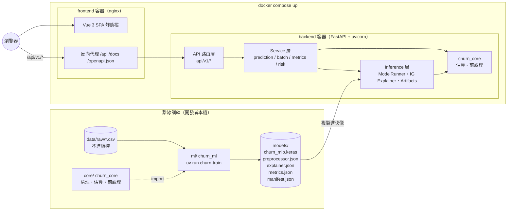

# 技術設計：Telco 顧客流失預測 Web App

- 功能代號：churn-prediction
- 依據：`requirements.md`（F1–F6、AC、NFR、第 9 節已決定事項）、`ui.md`（第 9 節 API 欄位需求、第 10 節 AC 對照）、主管派工單「已決定的事」
- 文件狀態：使用者已確認（2026-11-20：第 14 節 Q1–Q4 皆採推薦、安裝清單已同意）
- 修訂：2026-11-20 依使用者實測環境改為 Python 3.14.8、鎖定 tensorflow 2.22.0rc0／keras-nightly 3.16.0.dev2026101704／numpy 2.5.4／pandas 3.0.6、Node 22；新增 3.2.1 版本鎖定原則、R11、ADR-0008；R8、第 10.2／10.3 節、第 14 節安裝清單同步修改
- 本文件第 6 節「API 合約」是前後端**唯一合約**；欄位名稱、型別、必填、錯誤碼一律以此為準，實作時若需修改須先回報。

---

## 0. 現況與資料確認

- 專案目前沒有任何程式碼、不是 git repo；只有 `data/raw/WA_Fn-UseC_-Telco-Customer-Churn.csv` 與 `docs/specs/churn-prediction/`。
- 原始資料實際確認（2026-11-20 以搜尋統計）：

| 項目 | 結果 | 對設計的影響 |
|---|---|---|
| 筆數 | 7,043 筆＋表頭，21 欄，無引號欄位 | `pandas.read_csv` 直接讀 |
| Churn=Yes | 1,869 筆（26.54%） | 類別不平衡，見 4.4 |
| TotalCharges 空白 | 11 筆，值為一個空白字元 `" "` | 清理時 `strip()` 後空字串視為缺值 |
| 上述 11 筆的 tenure | **全部為 0**；且全資料集 tenure=0 恰好就是這 11 筆 | `tenure x MonthlyCharges = 0`，估算合理（ADR-0003） |
| tenure 範圍 | 0–72，無超過 72 | 驗證範圍 0–72 與資料一致 |
| MonthlyCharges | 皆 < 120 | 驗證 0–200 足夠寬鬆 |
| PhoneService=No 時 MultipleLines | 一律為 `No phone service`；PhoneService=Yes 時從不出現 `No phone service` | 後端可強制此一致性（422） |
| InternetService=No 時 6 個附加服務 | 一律為 `No internet service`；DSL/Fiber 時從不出現 `No internet service` | 同上 |
| 行尾 | CRLF | 讀取時無影響 |

---

## 1. 整體架構

### 1.1 一句話
Monorepo：`ml/` 離線訓練產出模型檔到 `models/`（進版控）→ `backend/`（FastAPI）啟動時載入模型檔提供預測、解釋、成效 API → `frontend/`（Vue 3 SPA，由 nginx 提供並反向代理 `/api`）。訓練與推論共用 `core/`（`churn_core` 套件）的前處理程式，杜絕 training-serving skew。

### 1.2 架構圖



### 1.3 分層與依賴方向（後端）

| 層 | 目錄 | 職責 | 可以依賴 |
|---|---|---|---|
| API 路由 | `churn_api/api/v1/` | HTTP 解析、Pydantic 驗證、呼叫 service、組回應；不含商業邏輯 | schemas、services（透過 `Depends`） |
| Schema | `churn_api/schemas/` | 請求／回應型別（OpenAPI 來源） | `churn_core.schema`（合法值常數） |
| Service | `churn_api/services/` | 估算 TotalCharges、前處理、預測、風險分級、因素排序、CSV 解析與逐列驗證 | `churn_core`、inference 的 **Protocol**（介面） |
| Inference | `churn_api/inference/` | 載入與驗證模型檔、Keras 推論、Integrated Gradients | `churn_core`、TensorFlow |
| 共用核心 | `core/src/churn_core/` | 欄位定義、清理、估算、前處理 fit/transform、中文標籤、範例資料 | pandas、numpy（**不依賴** TF／FastAPI／sklearn） |

- 依賴只往內：路由 → service → inference/core。Service 只認 `ModelRunner`、`Explainer` 兩個 Protocol，測試時注入假物件（不需 TensorFlow 即可測 service）。
- 物件組裝集中在 `main.py` 的 lifespan：讀設定 → 載入 `ArtifactBundle` → 建立 service → 放進 `app.state`；`dependencies.py` 提供 `Depends` 取用函式，測試用 `app.dependency_overrides` 替換。
- 模型只在啟動時載入一次；載入失敗**不讓服務掛掉**，而是標記「模型不可用」，讓 health 回 503、預測回 503（AC-1.9、AC-5.3）。

### 1.4 資料流（單筆預測）
1. 前端送 `POST /api/v1/predictions`（19 欄，TotalCharges 可省略／null）。
2. Pydantic 嚴格驗證（型別、列舉、範圍、電話／網路連動一致性）→ 不合法回 422。
3. Service：`churn_core.impute_total_charges` 補值並記錄 `is_estimated` → `Preprocessor.transform` 得 45 維向量。
4. `ModelRunner.predict_proba` 得機率 → 四捨五入到 3 位小數 → 依切點分級。
5. `Explainer.attribute`（IG）得 45 維歸因 → 依原始欄位加總為 19 個因素 → 取絕對值前 5 → 以 `churn_core.labels` 產生中文名稱。
6. 一次回傳機率、等級、切點、模型資訊、TotalCharges 估算資訊、前 5 因素（AC-2.6）。

### 1.5 不使用資料庫
沿用 requirements 4.4：MVP 無可寫入資料；不新增任何持久化。批次上傳只在記憶體處理（見 6.6、11）。ADR-0004 記錄。

---

## 2. 目錄結構

```
telco-churn-predictor/
├─ pyproject.toml            # uv workspace 根：成員、共用 dev 依賴、ruff/mypy/pytest/coverage 設定
├─ uv.lock                   # 唯一 Python 鎖定檔（三個成員共用，保證訓練與推論 TF 版本相同）
├─ .python-version           # 3.14.8（本機直譯器，uv 不下載 Python，見 3.2.1）
├─ core/                     # 共用核心（訓練與推論都 import）
│  ├─ pyproject.toml         # name = "churn-core"
│  ├─ src/churn_core/
│  │  ├─ schema.py           # 19 個特徵、合法值、數值範圍、目標欄、ID 欄、Literal 型別
│  │  ├─ cleaning.py         # 原始 CSV 清理（空白→缺值、Churn→0/1、移除 customerID）＋清理報告
│  │  ├─ imputation.py       # TotalCharges 缺值估算（唯一實作）
│  │  ├─ preprocessing.py    # Preprocessor：fit / transform / to_json / from_json、feature_groups
│  │  ├─ labels.py           # 欄位與選項中文名稱、因素顯示名稱產生
│  │  └─ examples.py         # 高／低風險範例（範本 CSV、測試、前端「載入範例」共用定義）
│  └─ tests/
├─ ml/                       # 離線訓練
│  ├─ pyproject.toml         # name = "churn-ml"；console scripts：churn-train、churn-verify
│  ├─ src/churn_ml/
│  │  ├─ config.py           # TrainConfig（種子、切分比例、epochs、不平衡策略、目標 Recall）
│  │  ├─ reproducibility.py  # 設定所有亂數種子與 TF 決定性
│  │  ├─ data.py             # 讀檔（找不到檔案的友善錯誤）、分層切分
│  │  ├─ models.py           # build_mlp()、build_logreg()
│  │  ├─ thresholds.py       # 決策門檻選擇
│  │  ├─ evaluate.py         # 指標、ROC 降採樣、混淆矩陣
│  │  ├─ export.py           # 寫出 models/*、manifest（雜湊、版本、套件版本）
│  │  ├─ pipeline.py         # run_training() 串起全部步驟
│  │  └─ cli.py              # churn-train、churn-verify 入口
│  └─ tests/
│     └─ fixtures/sample_telco.csv   # 合成樣本（約 120 列，含 TotalCharges 空白），CI 用
├─ backend/
│  ├─ pyproject.toml         # name = "churn-api"
│  ├─ Dockerfile
│  ├─ scripts/export_openapi.py
│  ├─ src/churn_api/
│  │  ├─ main.py             # create_app()、lifespan 組裝
│  │  ├─ settings.py         # pydantic-settings
│  │  ├─ logging_config.py   # JSON log formatter
│  │  ├─ middleware.py       # request id、存取 log
│  │  ├─ errors.py           # 錯誤碼、AppError、例外處理器、Pydantic 錯誤翻譯
│  │  ├─ dependencies.py     # Depends 取用 service
│  │  ├─ api/v1/{router,health,meta,predictions,batch,model_metrics}.py
│  │  ├─ schemas/{common,prediction,metrics,batch,meta}.py
│  │  ├─ services/{risk,prediction_service,metrics_service,csv_parser,batch_service}.py
│  │  └─ inference/{artifacts,model_runner,explainer}.py
│  └─ tests/
├─ contracts/openapi.json    # 由 backend 匯出、進版控；前端以此產生 TS 型別；CI 檢查是否過期
├─ frontend/
│  ├─ package.json, package-lock.json, vite.config.ts, tsconfig*.json, eslint.config.js, .prettierrc
│  ├─ Dockerfile, nginx.conf
│  └─ src/
│     ├─ main.ts, App.vue, router/index.ts, styles/theme.css
│     ├─ api/{client.ts, schema.gen.ts, predictions.ts, metrics.ts, batch.ts, meta.ts}
│     ├─ domain/{fields.ts, dependencies.ts, validation.ts, examples.ts, risk.ts, format.ts, csv.ts}
│     ├─ stores/{prediction.ts, performance.ts, batch.ts}
│     ├─ components/{layout,common,predict,performance,batch}/*.vue
│     └─ views/{PredictView,PerformanceView,BatchView}.vue
├─ models/                   # 訓練產物（進版控，見 5.1）
├─ data/raw/.gitkeep         # CSV 被 .gitignore 排除
├─ docs/adr/                 # ADR-0001 ～ 0008
├─ docs/images/              # README 截圖
├─ scripts/perf/             # 效能量測腳本（qa）
├─ docker-compose.yml, .env.example, .gitignore, .dockerignore, .editorconfig
├─ .github/workflows/ci.yml
└─ README.md
```

理由：
- `core/` 獨立成套件而不是放在 `backend/` 或 `ml/` 底下：兩邊都要 import，且 backend 映像不該帶 sklearn 與訓練程式；獨立套件讓依賴最小、責任清楚。
- `models/` 在根目錄而非 `ml/artifacts/`：它是「訓練與服務之間的交接物」，不屬於任一方。

---

## 3. 技術選型

### 3.1 已決定（沿用派工單）
FastAPI、TensorFlow/Keras（主模型）、scikit-learn 邏輯迴歸（基準）、Vue 3 + TS strict + Vite + Pinia + Element Plus、無資料庫、無登入、Docker 本機。

### 3.2 本文件新決定

| 項目 | 選擇 | 候選與取捨 | 理由 |
|---|---|---|---|
| Python 套件管理 | **uv 0.10.2**（使用者本機已安裝；workspace + `uv.lock`） | pip-tools：只能鎖單一 requirements、無 workspace、跨平台鎖需各自產生；Poetry：解析慢、多套件 workspace 不原生 | ① workspace 讓 `core` 被 `ml`、`backend` 以路徑依賴共用，且**一份鎖定檔**保證訓練與推論的 TF／numpy 版本完全相同（NFR-5、NFR-6）② 鎖定檔同時涵蓋 Windows（開發）與 Linux x86_64（Docker／CI）③ 速度快、有官方映像，CI 與 Docker 建置快 |
| Python 版本 | **3.14（本機 3.14.8，`C:\Program Files\Python314`）**（2026-11-20 使用者調整：原寫 3.12） | 3.12 | 使用者電腦上的 Python／TensorFlow 是課程指定、老師確認過的版本，不可更動；專案以此為準。版本鎖定原則見 3.2.1 |
| 預測解釋方法 | **Integrated Gradients（自行以 `tf.GradientTape` 實作）** | SHAP Kernel／Deep、LR 係數、置換重要性、遮蔽法 | 見 3.3 與 ADR-0005 |
| 前處理實作 | **自寫 `Preprocessor`，參數存 JSON** | sklearn `ColumnTransformer` + joblib/pickle | pickle 綁定 sklearn 版本、不可讀、有反序列化風險；backend 若要載入就得裝 sklearn。JSON 可讀、可 diff、backend 不需 sklearn；欄位只有 19 個，自寫約百行且可完整測試（ADR-0006） |
| 圖表庫 | **Chart.js 4 + vue-chartjs**（只用於 ROC 曲線）；混淆矩陣、因素長條用 HTML/CSS 元件 | ECharts：功能多但 tree-shaking 後仍約 3–4 倍大，2×2 熱度格用它是殺雞用牛刀；純 SVG 自畫：零依賴但要自己處理座標軸、圖例、響應式重繪 | ROC 需要折線、虛線、標記形狀、圖例、響應式重繪，Chart.js 都內建且體積小；混淆矩陣與發散長條用 HTML 元件，格內文字與 `aria-label` 更好做無障礙（ui.md 8.2），也不需 canvas 替代表 |
| HTTP 用戶端（前端） | 原生 `fetch` 包一層 `api/client.ts` | axios | 需求只有 JSON、multipart、逾時，fetch + AbortController 足夠，少一個依賴 |
| 前端 API 型別 | **openapi-typescript** 由 `contracts/openapi.json` 產生 `schema.gen.ts` | 手寫型別 | 合約即程式：後端改欄位而前端沒跟上時，`vue-tsc` 直接報錯；CI 檢查 openapi.json 與後端一致（Q2 已決定採用） |
| Element Plus 引入 | unplugin-vue-components + unplugin-auto-import 按需引入 | 全量引入 | ui.md 11 要求按需；減少 bundle |
| JSON log | 標準函式庫 `logging` + 自寫 JSON Formatter | structlog、python-json-logger | 欄位固定、需求簡單，約 30 行即可，少一個依賴 |
| E2E 測試 | Playwright（qa 使用） | Cypress；只做手動 | 支援 Chromium／WebKit（對應 Safari 需求 NFR-9）；Q3 已決定只在本機跑、不進 CI |
| Node 版本 | **22（沿用本機 v22.23.4、npm 10.9.9）**（2026-11-20 使用者調整：原寫 24） | 24 LTS | 沿用使用者已安裝版本，不另裝；`package.json` 設 `"engines": {"node": ">=22 <23"}`，並放 `.nvmrc`／`.node-version` 寫 `22` |
| 容器基底 | backend：`python:3.14.8-slim-trixie`（與本機 Python patch 版本相同；uv 以 `COPY --from=ghcr.io/astral-sh/uv:0.10.2 /uv /bin/uv` 帶入，**不用** uv 自帶 Python 的映像）；frontend：`node:22-alpine` 建置 → `nginxinc/nginx-unprivileged:alpine` 執行 | distroless：除錯困難、TF 需 glibc | slim + 非 root；直譯器版本與本機一致；nginx-unprivileged 預設非 root 監聽 8080 |

### 3.2.1 Python 環境與版本鎖定原則（2026-11-20 使用者調整）

**原則**
1. **絕不修改使用者全域 Python 環境**（`C:\Program Files\Python314`）：任何任務都不得執行全域 `pip install`／`pip uninstall`／升級，也不得改全域 site-packages。查詢本機版本只用唯讀指令（如 `python -m pip show`、`python -c "import tensorflow as tf; print(tf.__version__)"`）。
2. 專案一律使用 uv 在 repo 根目錄建立的 `.venv`，**以本機 Python 3.14.8 為基底**，裡面安裝與本機**完全相同**版本的核心套件。
3. **禁止 uv 下載 Python 直譯器**：根 `pyproject.toml` 設定
   ```toml
   [project]            # 各成員同樣設定
   requires-python = "==3.14.*"

   [tool.uv]
   required-version = "==0.10.2"
   python-preference = "only-system"   # 只用系統已安裝的 Python
   python-downloads = "never"          # 禁止自動下載直譯器
   environments = [
     "sys_platform == 'win32' and platform_machine == 'AMD64'",
     "sys_platform == 'linux' and platform_machine == 'x86_64'",
   ]
   ```
   `.python-version` 寫 `3.14.8`；建立環境指令：`uv venv --python "C:\Program Files\Python314\python.exe"` 後 `uv sync`（README 寫明）。`environments` 只解析 Windows（開發）與 Linux x86_64（Docker／CI）兩個平台，避免為了用不到的平台（macOS、ARM）卡在預發行版本沒有 wheel。

**版本表**

| 套件 | 版本 | 鎖定方式 | 來源 |
|---|---|---|---|
| Python | 3.14.8 | `requires-python = "==3.14.*"`＋`.python-version`＝3.14.8；Docker 映像 `python:3.14.8-slim-trixie` | 本機已安裝，沿用 |
| tensorflow | 2.22.0rc0 | `==2.22.0rc0`（`ml`、`backend`） | 本機已安裝版本，專案 `.venv` 安裝相同版本 |
| keras-nightly（提供 `import keras`） | 3.16.0.dev2026101704 | `keras-nightly==3.16.0.dev2026101704`（`ml`、`backend`）；主管已唯讀確認本機發行名稱即 `keras-nightly`，且 tensorflow 2.22.0rc0 依賴的就是 `keras-nightly`，無命名衝突。**不得**另宣告 `keras` 套件 | 同上 |
| numpy | 2.5.4 | `==2.5.4`（`core`） | 同上 |
| pandas | 3.0.6 | `==3.0.6`（`core`） | 同上 |
| scikit-learn、fastapi、uvicorn[standard]、pydantic-settings、python-multipart、dev 工具 | 由 T1 選擇「有 cp314 wheel、且與上列鎖定版本相容」的最新穩定版，並在 `pyproject.toml` 以 `==` 鎖定 | `==`，實際版本由 T1 回報後補入本表 | 新安裝（僅裝進專案 `.venv`） |
| matplotlib | 3.11.2 | 不列為專案依賴（本專案不需要） | 本機已安裝，不使用 |

- 預發行版本解析：直接依賴以 `==` 精確指定預發行版本時 uv 會接受；不另開全域 `prerelease = "allow"`，避免其他套件被解析成預發行版。
- 若 uv 解析時要求更動上列任一鎖定版本（例如新套件要求不同的 numpy／pandas 版本），**停下回報主管**，不得自行改版本或改套件名稱。

### 3.3 解釋方法比較（摘要；完整版寫入 ADR-0005）

| 方法 | 是否解釋「實際在服務的 Keras 模型」 | 單筆延遲（估計，CPU） | 映像增量 | 優點 | 缺點 |
|---|---|---|---|---|---|
| SHAP KernelExplainer | 是 | 數百 ms～數秒（需背景樣本與上千次模型呼叫） | 約 +150 MB（shap、numba、llvmlite） | Shapley 理論、模型無關 | 慢，可能超過 p95 500ms；近似值有抽樣誤差，需固定種子才可重現 |
| SHAP Deep/GradientExplainer | 是 | 數十 ms | 約 +150 MB | 快 | 與 TF2／Keras 3 相容性問題多，升級易壞 |
| **Integrated Gradients** | **是** | **約 10–30 ms**（一次 65 列的前向＋反向傳遞） | **0**（TF 已在映像中） | 具「完整性」公理：各特徵歸因加總 = p(x) − p(基準)，數值可解釋為機率差；完全確定、無抽樣 | 需選基準點；在 one-hot 之間做內插屬於「資料流形外」的點 |
| LR 係數 × 特徵值 | **否**（解釋的是另一個模型） | < 1 ms | 0 | 精確、簡單 | 畫面機率來自 Keras、因素卻來自 LR，兩者可能方向相反，面試時無法自圓其說 |
| 置換重要性 | 否（全域重要性） | — | 0 | 適合整體特徵重要性頁 | 不是單筆解釋，無法滿足 AC-2.3「兩筆的因素不同」 |
| 遮蔽法（逐欄換成基準值看機率變化） | 是 | 約 5 ms | 0 | 直覺 | 各因素不可加總、忽略交互作用、結果依替代值而定 |

**決定：Integrated Gradients。** 理由：唯一同時滿足「解釋的就是畫面機率的那個模型」「無新依賴」「延遲遠低於 500ms」「完全確定（AC-2.4）」「數值有明確意義」的選項。

IG 規格（實作依據）：
- 輸入空間：前處理後 45 維向量（float32）。
- 基準點：訓練子集前處理後向量的**平均值**（＝「平均顧客」）；訓練時算好存在 `explainer.json`，同時存 `baseline_probability = p(基準)`。
- 輸出：模型 sigmoid 後的**機率**（不是 logit），所以歸因單位是「機率」，例如 `+0.183` = 相較平均顧客推高約 18.3 個百分點。
- 積分：`alphas = linspace(0, 1, m+1)`，`m = IG_STEPS`（預設 64），梯形法；一次以 batch（m+1 列）計算梯度。以 `tf.function(input_signature=…)` 固定形狀，啟動時暖機一次避免首個請求追蹤延遲。
- 聚合：同一原始欄位的 one-hot 欄位歸因**相加**（IG 對輸入維度可加），得到 19 個因素；數值欄位為單欄。
- 排序：依 `|impact|` 由大到小；相同時依 `churn_core.schema.FEATURES` 的固定順序，保證順序確定（AC-2.4）。
- 方向：`impact > 0` → `increase`（推高風險）；`< 0` → `decrease`（拉低風險）；`= 0`（理論上僅在 x 等於基準時）→ 歸為 `decrease` 並不會進前 5（實務上不出現）。
- 正確性驗證（單元測試）：① 完整性：`|Σ impact − (p(x) − p(基準))| < 0.01`；② 對「無隱藏層的 sigmoid 模型」在 logit 空間的 IG 應等於 `w·(x−b)`（已知解析解）。

---

## 4. 資料前處理與訓練流程（`ml/`）

### 4.1 指令
- 訓練：`uv run churn-train`（預設讀 `data/raw/WA_Fn-UseC_-Telco-Customer-Churn.csv`，輸出到 `models/`）
  - 選項：`--data PATH`、`--output-dir PATH`、`--seed INT`（預設 42）、`--epochs INT`（上限，預設 100）、`--imbalance-strategy {threshold_tuning,class_weight}`、`--target-recall FLOAT`（預設 0.75）
- 驗證產物：`uv run churn-verify --artifacts models [--compare OTHER_DIR]`
  - 檢查 5 個檔案存在、manifest 雜湊相符、`customerID` 不在特徵中、NFR-1（AUC ≥ 0.82、Recall ≥ 0.70）、NFR-2（Keras AUC ≥ LR AUC − 0.01）；`--compare` 時檢查兩次訓練的 Keras 測試 AUC 差 ≤ 0.01（AC-4.6）。未達標 exit 1 並印出哪一項未達。

### 4.2 流程步驟

| # | 步驟 | 細節 | 對應 |
|---|---|---|---|
| 1 | 設定種子 | `PYTHONHASHSEED`、`random.seed`、`np.random.seed`、`keras.utils.set_random_seed(seed)`、`tf.config.experimental.enable_op_determinism()`；sklearn 一律傳 `random_state=seed` | AC-4.6、NFR-5 |
| 2 | 讀檔 | 檔案不存在 → 印出「找不到資料檔，請從 Kaggle 下載並放到 data/raw/」＋下載網址（https://www.kaggle.com/datasets/blastchar/telco-customer-churn），exit code 2，不印堆疊（CLI 層攔截自訂例外 `DataFileNotFoundError`） | AC-4.2 |
| 3 | 結構檢查 | 欄位齊全、類別值皆在合法集合內，否則友善錯誤 exit 2 | — |
| 4 | 清理 | `churn_core.cleaning.clean_raw_frame`：所有字串 `strip()`；TotalCharges 空字串→NaN→`float`；Churn Yes/No→1/0；移除 `customerID`；回傳 `CleaningReport(total_charges_blank=11, rows=7043)` 並寫入 log 與 manifest | AC-4.3、AC-4.7 |
| 5 | 估算 | `churn_core.imputation.impute_total_charges`：NaN → `tenure × MonthlyCharges`（訓練中 11 筆皆得 0） | AC-4.3、ADR-0003 |
| 6 | 切分 | `train_test_split(stratify=y, test_size=0.2)` → 測試集（1,409 筆）**封存**；剩餘 80% 再 `stratify` 切出 20% 為驗證集 → 訓練子集約 4,507、驗證約 1,127、測試 1,409 | AC-4.4 |
| 7 | 擬合前處理 | `Preprocessor.fit(訓練子集)`：只學數值欄位的平均與標準差；類別清單來自 `schema.py` 固定順序（不從資料學，避免切分造成欄位不同） | AC-4.4（測試集不參與擬合） |
| 8 | 訓練 LR | `LogisticRegression(C=1.0, max_iter=1000, solver="lbfgs", random_state=seed)` | AC-3.1 |
| 9 | 訓練 Keras | 見 4.3；EarlyStopping 監看驗證集 AUC | — |
| 10 | 不平衡實驗 | 兩個模型各訓練「不加權」與「class_weight=balanced」兩版（Keras 共 2 次訓練，約 1 分鐘內），在測試集回報 Recall／Precision／AUC，寫入 `metrics.json.imbalance_experiment` | AC-4.5 |
| 11 | 選門檻 | 在**驗證集**選決策門檻（4.4） | AC-4.4（測試集不參與） |
| 12 | 評估 | 匯出模型（依 `--imbalance-strategy`）在**測試集**計算 AUC、Precision、Recall、F1、Accuracy、混淆矩陣、ROC | AC-3.1、3.2 |
| 13 | 匯出 | 寫出 5 個檔案（5.1）；log 印出成效摘要 | AC-4.1、4.8 |
| 14 | 估算偏差統計 | 在訓練子集計算 `|TotalCharges − tenure×MonthlyCharges| / TotalCharges` 的中位數與 P90，寫入 manifest（供 ADR-0003 說明估算誤差） | ADR-0003 |

### 4.3 Keras 模型
- `Input(45) → Dense(32, relu, L2=1e-4) → Dropout(0.2) → Dense(16, relu, L2=1e-4) → Dropout(0.2) → Dense(1, sigmoid)`
- `Adam(lr=1e-3)`、`binary_crossentropy`、`batch_size=64`、`epochs` 上限 100、`EarlyStopping(monitor="val_auc", mode="max", patience=10, restore_best_weights=True)`
- 只做這一組固定架構，不做超參數搜尋（requirements 第 8 節）。CPU 預估 < 1 分鐘，全流程 < 3 分鐘（NFR-5 上限 10 分鐘）。

### 4.4 類別不平衡、指標與門檻
- 兩種策略皆實作，`--imbalance-strategy` 決定**匯出哪一版**：
  - `threshold_tuning`（**預設**，Q1 已決定）：不加權訓練，輸出機率保持校準（與真實流失比例一致），在驗證集調低決策門檻以提高 Recall。
  - `class_weight`：`balanced` 類別權重訓練，Recall 提高但輸出機率整體偏高（未校準）。
- 為什麼推薦 `threshold_tuning`：畫面顯示的是「流失機率」並用 30%／60% 絕對切點分級；加權訓練會讓機率系統性偏高，「60%」不再代表約 6 成會流失，切點失去意義。兩者的比較結果仍會被記錄（AC-4.5），這本身就是面試亮點。
- 門檻選擇規則（`thresholds.py`）：候選門檻 0.05–0.95 間隔 0.01；在驗證集中選「Recall ≥ `target_recall`（0.75，比 NFR-1 的 0.70 留餘裕）條件下 F1 最大」者；若沒有任何門檻達標，選 Recall 最大者並在 log 與 `metrics.json.warnings` 記錄。LR 以同一規則獨立選門檻，比較才公平。
- 主要指標：ROC-AUC（與門檻無關）與 Recall（漏抓流失客戶的代價高）；Accuracy 只作參考（全猜不流失約 73.5%）。
- **決策門檻 ≠ 風險切點**：決策門檻用於成效頁的 Precision／Recall／混淆矩陣；30%／60% 是畫面上的風險分級（業務規則），兩者獨立，成效頁說明文字要寫清楚。

### 4.5 可重現性
- 種子（4.2 步驟 1）、`uv.lock` 鎖定所有版本、CPU 決定性運算；`churn-verify --compare` 驗證 AC-4.6。
- manifest 記錄：種子、資料列數、資料檔 SHA-256、特徵數、清理報告、Python 與主要套件版本（tensorflow、keras-nightly、numpy、pandas、scikit-learn）、訓練起訖時間（AC-4.8）。

---

## 5. 模型產物與載入

### 5.1 `models/` 檔案（全部進版控，總大小預估 < 200 KB）

| 檔案 | 格式 | 內容 | 讀取者 |
|---|---|---|---|
| `churn_mlp.keras` | Keras 3 原生格式 | 匯出的 Keras 模型（無自訂層） | backend |
| `preprocessor.json` | JSON | 見 5.2 | backend、ml |
| `explainer.json` | JSON | `{"method":"integrated_gradients","baseline":[45 個 float],"baseline_probability":0.xxx}` | backend |
| `metrics.json` | JSON | 與 `GET /api/v1/model/metrics` 回應的 `data` 結構**完全相同**（6.5），後端只做驗證後轉發 | backend |
| `manifest.json` | JSON | `model_version`、`trained_at`（ISO 8601 UTC）、`seed`、`data`（列數、SHA-256、清理報告）、`n_features`、`feature_names`、`packages`、`files`（各檔 SHA-256）、`total_charges_estimate_error`、`imbalance_strategy` | backend（health、驗證）、churn-verify |

- `model_version` 格式：`YYYYMMDD-<churn_mlp.keras 的 SHA-256 前 8 碼>`。
- LR 模型**不匯出**：它只用於訓練時的比較，成效數字已寫入 `metrics.json`；backend 不需要 sklearn。
- 版本回滾：模型檔在 git 中，`git revert` 即可回到上一版模型（無資料庫 migration）。

### 5.2 `preprocessor.json` 結構
```json
{
  "format_version": 1,
  "categorical": { "gender": ["Female", "Male"], "Contract": ["Month-to-month", "One year", "Two year"], "...": [] },
  "passthrough": ["SeniorCitizen"],
  "numeric": { "tenure": {"mean": 32.4, "std": 24.5}, "MonthlyCharges": {"mean": 64.8, "std": 30.1}, "TotalCharges": {"mean": 2280.0, "std": 2266.0} },
  "feature_names": ["gender=Female", "gender=Male", "...", "tenure", "MonthlyCharges", "TotalCharges"],
  "feature_groups": { "gender": [0, 1], "...": [], "tenure": [42] }
}
```
（數字為示意。）特徵數：16 個類別欄位 one-hot 共 41 維＋SeniorCitizen 1 維＋3 個數值 = **45 維**。`transform` 遇到未知類別直接 `ValueError`（API 層已先驗證，正常不會發生）。數值以 float64 計算後轉 float32。

### 5.3 後端載入（`inference/artifacts.py`）
1. 讀 `MODEL_DIR/manifest.json`；逐檔比對 SHA-256（防止只換了一半檔案）。
2. `keras.saving.load_model(path, compile=False)`（`safe_mode` 預設開啟）；`Preprocessor.from_json`；讀 `explainer.json`；驗證 `len(baseline) == n_features == model 輸入維度`。
3. 建立 `KerasModelRunner` 與 `IntegratedGradientsExplainer`，用 `churn_core.examples.HIGH_RISK_EXAMPLE` 暖機一次。
4. 任一步失敗 → log `event=model_load_failed`（含原因，不含堆疊以外的機密），`app.state.model_status = unavailable`；服務照常啟動。
5. `metrics.json` 獨立載入：缺檔 → 成效 API 回 404 `METRICS_NOT_FOUND`（ui 空狀態）；檔案存在但格式錯 → 500 `INTERNAL_ERROR` 並 log。
- 推論呼叫 `model(x, training=False)`（不用 `model.predict`，避免每次呼叫建立 data adapter 的額外開銷）；批次時分塊（每塊 2,048 列）。

---

## 6. API 合約（前後端唯一合約）

### 6.1 通則
- Base path：`/api/v1`。Swagger UI：`/docs`；OpenAPI JSON：`/openapi.json`（nginx 皆代理到 backend）。
- 權限：全部 API **公開、免驗證**（requirements 第 8 節不做登入）；以 CORS 白名單、上傳上限、輸入驗證控管風險。
- Content-Type：JSON 請求為 `application/json`；批次上傳為 `multipart/form-data`。
- 每個回應帶 `X-Request-ID` 標頭（請求有帶合法值則沿用，否則產生 UUID4）。
- 輸入特徵欄位名稱**沿用資料集原始欄名**（`tenure`、`MonthlyCharges`…），與 CSV 表頭一對一，避免多一層對照；API 自身產生的回應欄位一律 `snake_case`。
- 數值：機率一律為 0–1 浮點、**四捨五入（half-up）到小數 3 位**後回傳；風險等級以**四捨五入後**的值判定，確保畫面「30.0%」不會出現「低風險」的矛盾。
- 範例（Swagger 的 request/response examples）需在 Pydantic schema 以 `json_schema_extra`／`openapi_examples` 寫入，涵蓋成功、422、503（AC-5.2）。

### 6.2 共用型別

**CustomerFeatures**（單筆請求本體；批次每列套用同一套規則）

| 欄位 | 型別 | 必填 | 合法值／範圍 |
|---|---|---|---|
| gender | string enum | 是 | `Female`、`Male` |
| SeniorCitizen | integer enum | 是 | `0`、`1`（嚴格整數，`"0"`、`true` 皆拒絕） |
| Partner | string enum | 是 | `Yes`、`No` |
| Dependents | string enum | 是 | `Yes`、`No` |
| tenure | integer | 是 | 0–72（嚴格整數，`10.5`、`"10"` 拒絕） |
| PhoneService | string enum | 是 | `Yes`、`No` |
| MultipleLines | string enum | 是 | `Yes`、`No`、`No phone service` |
| InternetService | string enum | 是 | `DSL`、`Fiber optic`、`No` |
| OnlineSecurity、OnlineBackup、DeviceProtection、TechSupport、StreamingTV、StreamingMovies | string enum | 是 | `Yes`、`No`、`No internet service` |
| Contract | string enum | 是 | `Month-to-month`、`One year`、`Two year` |
| PaperlessBilling | string enum | 是 | `Yes`、`No` |
| PaymentMethod | string enum | 是 | `Electronic check`、`Mailed check`、`Bank transfer (automatic)`、`Credit card (automatic)` |
| MonthlyCharges | number | 是 | 0–200（含端點；數字型別，字串拒絕） |
| TotalCharges | number \| null | 否 | 0–10,000；省略或 `null` → 以 `tenure × MonthlyCharges` 估算 |

- 大小寫與空白必須與上表完全一致（不做自動修正）。
- 一致性規則（違反回 422，`field` 指向子欄位）：
  - `PhoneService = No` ⇔ `MultipleLines = No phone service`
  - `InternetService = No` ⇔ 6 個附加服務皆為 `No internet service`
- 不認識的額外欄位 → 422（`extra="forbid"`，可抓出拼錯的欄名）。

**RiskLevel**：`"low" | "medium" | "high"`；`p < medium` → low；`medium ≤ p < high` → medium；`p ≥ high` → high。

**RiskThresholds**：`{ "medium": number, "high": number }`（預設 0.30、0.60，來自設定）。

**ModelInfo**：`{ "name": string, "display_name": string, "version": string, "trained_at": string(ISO 8601) }`；例：`{"name":"keras_mlp","display_name":"Keras 神經網路","version":"20261120-a1b2c3d4","trained_at":"2026-11-20T08:00:00Z"}`。

### 6.3 錯誤格式（所有非 2xx 回應，NFR-7）
```json
{
  "error": {
    "code": "VALIDATION_ERROR",
    "message": "輸入資料有誤，請檢查標示的欄位。",
    "details": [
      { "field": "tenure", "row": null, "type": "out_of_range", "reason": "在網月數需為 0 至 72 的整數" }
    ],
    "meta": null,
    "request_id": "6f1c2a9e-1b7d-4d1f-9a55-2b1b8f0c9d11"
  }
}
```

| 欄位 | 型別 | 必有 | 說明 |
|---|---|---|---|
| code | string | 是 | 機器判斷用，見下表 |
| message | string | 是 | 繁中、給人看、不含路徑或堆疊 |
| details | array | 是（可為空陣列） | 欄位／列級錯誤 |
| details[].field | string \| null | 是 | 原始欄名（如 `tenure`）；整份檔案層級錯誤為 null |
| details[].row | integer \| null | 是 | 批次才有：**與 Excel 開啟時左側列號一致**（表頭為第 1 列，第一筆資料為第 2 列）；單筆為 null |
| details[].type | string | 是 | `missing`、`invalid_type`、`invalid_choice`、`out_of_range`、`inconsistent`、`extra_field`、`missing_column` |
| details[].reason | string | 是 | 繁中具體原因（如「需為 0 至 72 的整數」「不是合法選項，可用值：Yes、No」） |
| meta | object \| null | 是 | 補充資訊（例：`INVALID_ROWS` 的總數、上限值） |
| request_id | string | 是 | 與 `X-Request-ID` 相同，方便對照 log |

**錯誤碼總表**

| HTTP | code | 何時 | 前端處理 |
|---|---|---|---|
| 400 | `FILE_EMPTY` | 上傳 0 位元組或只有表頭 | 批次錯誤 alert（AC-6.6） |
| 404 | `METRICS_NOT_FOUND` | `metrics.json` 不存在 | 成效頁空狀態（ui 4.2） |
| 404 | `NOT_FOUND` | 路徑不存在 | 一般錯誤 |
| 405 | `METHOD_NOT_ALLOWED` | 方法不允許 | 一般錯誤 |
| 413 | `FILE_TOO_LARGE` | 檔案 > `BATCH_MAX_FILE_BYTES`；`meta: {"max_file_bytes": 5242880}` | 超限 alert（AC-6.8） |
| 413 | `TOO_MANY_ROWS` | 資料列 > `BATCH_MAX_ROWS`；`meta: {"max_rows": 10000, "rows": 12000}` | 超限 alert（AC-6.8） |
| 415 | `UNSUPPORTED_FILE_TYPE` | 副檔名非 `.csv`、無法以 UTF-8（含 BOM）解碼、或無法解析為 CSV | 非 CSV alert（AC-6.6） |
| 422 | `VALIDATION_ERROR` | 單筆請求驗證失敗（含 JSON 格式錯誤） | 對應欄位下方顯示 `reason`（AC-1.8） |
| 422 | `MISSING_COLUMNS` | 批次缺少必要欄位；`details` 每個缺少欄一筆（`type=missing_column`, `field=欄名`） | 「缺少欄位：Contract、tenure」（AC-6.6） |
| 422 | `INVALID_ROWS` | 批次有不合法列，整份拒絕；`details` 只回**前 20 筆**錯誤（依列號、欄位順序）；`meta: {"total_errors": 57, "invalid_row_count": 31}` | 列表＋「另有 N 筆」（N = total_errors − 20）（AC-6.7） |
| 500 | `INTERNAL_ERROR` | 未預期錯誤（堆疊只進 log） | 「服務暫時無法使用」（AC-1.9） |
| 503 | `MODEL_UNAVAILABLE` | 模型未載入或載入失敗 | 「服務暫時無法使用」＋重試（AC-1.9） |

- 網路中斷、逾時、非 JSON 回應：前端 `client.ts` 一律轉成 `code = "NETWORK_ERROR"`（前端自定，不是後端錯誤碼），畫面同 503。
- Pydantic 錯誤翻譯：`errors.py` 以「錯誤 type → 繁中模板」對照表產生 `reason`；每個欄位的範圍訊息與 ui.md 3.2 表格文字一致（如 tenure：「在網月數需為 0 至 72 的整數」）。

### 6.4 API 一覽

| 方法 | 路徑 | 用途 | 成功 | 可能錯誤 | AC |
|---|---|---|---|---|---|
| GET | `/api/v1/health` | 健康檢查＋模型版本 | 200 | 503 | AC-5.3 |
| GET | `/api/v1/meta` | 前端所需設定（切點、批次上限） | 200 | — | AC-6.8 文案、ui 3.4 |
| POST | `/api/v1/predictions` | 單筆預測＋前 5 因素 | 200 | 422、503 | F1、F2 |
| GET | `/api/v1/model/metrics` | 成效頁資料 | 200 | 404、500 | F3 |
| POST | `/api/v1/predictions/batch` | 批次 CSV 預測 | 200 | 400、413、415、422、503 | F6 |
| GET | `/api/v1/predictions/batch/template` | 下載範本 CSV | 200 | — | AC-6.1 |

### 6.5 各 API 詳細

#### 6.5.1 `GET /api/v1/health`
- 200：
```json
{ "status": "ok", "model_loaded": true, "model": { "name": "keras_mlp", "display_name": "Keras 神經網路", "version": "20261120-a1b2c3d4", "trained_at": "2026-11-20T08:00:00Z" } }
```
- 503：錯誤格式，`code = MODEL_UNAVAILABLE`，`message = "模型尚未載入，服務暫時無法使用。"`
- 用途：docker compose healthcheck、AC-5.3。

#### 6.5.2 `GET /api/v1/meta`
- 200（不依賴模型是否載入）：
```json
{
  "risk_thresholds": { "medium": 0.30, "high": 0.60 },
  "batch_limits": { "max_file_bytes": 5242880, "max_rows": 10000 },
  "input_ranges": { "tenure": {"min": 0, "max": 72}, "MonthlyCharges": {"min": 0, "max": 200}, "TotalCharges": {"min": 0, "max": 10000} }
}
```
- 前端：批次頁上限文案、單筆結果的切點說明在**尚未預測時**的顯示。前端表單驗證範圍採 `domain/fields.ts` 常數（與本表一致），`input_ranges` 供未來改由 API 驅動，MVP 不強制使用。

#### 6.5.3 `POST /api/v1/predictions`
- Request：`CustomerFeatures`（6.2）。範例（高風險範例，TotalCharges 省略）：
```json
{
  "gender": "Female", "SeniorCitizen": 0, "Partner": "No", "Dependents": "No", "tenure": 1,
  "PhoneService": "Yes", "MultipleLines": "No", "InternetService": "Fiber optic",
  "OnlineSecurity": "No", "OnlineBackup": "No", "DeviceProtection": "No", "TechSupport": "No",
  "StreamingTV": "Yes", "StreamingMovies": "Yes", "Contract": "Month-to-month",
  "PaperlessBilling": "Yes", "PaymentMethod": "Electronic check", "MonthlyCharges": 100.0
}
```
- 200 Response：

| 欄位 | 型別 | 必有 | 說明 |
|---|---|---|---|
| probability | number | 是 | 0–1，3 位小數（AC-1.2 前端顯示 ×100 取 1 位） |
| risk_level | RiskLevel | 是 | 依四捨五入後機率判定 |
| risk_thresholds | RiskThresholds | 是 | 本次使用的切點（ui 3.4 說明文字由此產生） |
| model | ModelInfo | 是 | 「模型：Keras 神經網路」 |
| total_charges | object | 是 | `{ "value": number, "is_estimated": boolean }`；`value` 為實際用於預測的值（2 位小數）（AC-1.14、1.15、1.16） |
| top_factors | Factor[] | 是 | 恰 5 筆，依 `abs(impact)` 由大到小（AC-2.1） |
| top_factors[].feature | string | 是 | 原始欄名，**只作前端 key，不顯示**（AC-2.2） |
| top_factors[].label | string | 是 | 中文顯示名，格式「欄位中文：值中文」（如「合約類型：月繳」「在網月數：1 個月」「月費：$100.00」「累計費用：$100.00（估算）」） |
| top_factors[].direction | string enum | 是 | `increase`（推高風險）／`decrease`（拉低風險） |
| top_factors[].impact | number | 是 | 帶正負號、單位為機率、3 位小數；前端顯示為百分點（`+18.3 百分點`），長條長度以 5 筆中最大 `abs(impact)` 為 100% |
| explanation | object | 是 | `{ "method": "integrated_gradients", "baseline_probability": number }`；`baseline_probability` 為「平均顧客」機率，前端可選擇顯示「相較平均顧客（xx%）」 |

```json
{
  "probability": 0.724,
  "risk_level": "high",
  "risk_thresholds": { "medium": 0.30, "high": 0.60 },
  "model": { "name": "keras_mlp", "display_name": "Keras 神經網路", "version": "20261120-a1b2c3d4", "trained_at": "2026-11-20T08:00:00Z" },
  "total_charges": { "value": 100.0, "is_estimated": true },
  "top_factors": [
    { "feature": "Contract", "label": "合約類型：月繳", "direction": "increase", "impact": 0.183 },
    { "feature": "tenure", "label": "在網月數：1 個月", "direction": "increase", "impact": 0.142 },
    { "feature": "InternetService", "label": "網路服務：光纖", "direction": "increase", "impact": 0.095 },
    { "feature": "PaymentMethod", "label": "付款方式：電子支票", "direction": "increase", "impact": 0.061 },
    { "feature": "TechSupport", "label": "技術支援服務：無", "direction": "increase", "impact": 0.033 }
  ],
  "explanation": { "method": "integrated_gradients", "baseline_probability": 0.231 }
}
```
（數值為示意。）
- 422：`VALIDATION_ERROR`，`details` 列出所有錯誤欄位（不只第一個）。503：`MODEL_UNAVAILABLE`。
- 確定性：同一輸入兩次回應完全相同（AC-1.11、2.4）；TotalCharges 省略與手填估算值的預測完全相同（AC-1.14，兩者進入 `transform` 的值相同）。

#### 6.5.4 `GET /api/v1/model/metrics`
- 200 Response（＝ `models/metrics.json` 內容）：

| 欄位 | 型別 | 說明 |
|---|---|---|
| primary_model | string | 匯出並用於預測的模型 key：`keras_mlp` |
| model_version | string | 同 manifest |
| trained_at | string | ISO 8601 UTC（AC-3.3） |
| random_seed | integer | 種子 |
| imbalance_strategy | string enum | `threshold_tuning` \| `class_weight`；前端依此選對應的白話說明（AC-3.5） |
| target_recall | number | 選門檻時的 Recall 目標 |
| dataset | object | `train_size`（訓練子集）、`validation_size`、`test_size`、`test_churn_rate`（0–1）、`majority_class_accuracy`（＝1 − test_churn_rate，AC-3.4 文案用） |
| models | ModelResult[] | 恰 2 筆，順序固定：`logistic_regression`、`keras_mlp` |
| models[].key | string | `logistic_regression` \| `keras_mlp` |
| models[].display_name | string | 「邏輯迴歸（基準）」「Keras 神經網路」 |
| models[].decision_threshold | number | 該模型在驗證集選出的門檻（2 位小數） |
| models[].metrics | object | `roc_auc`、`precision`、`recall`、`f1`、`accuracy`（皆 0–1，4 位小數；前端顯示 3 位） |
| models[].confusion_matrix | object | `tn`、`fp`、`fn`、`tp`（整數，測試集，於該模型門檻下） |
| models[].roc_curve | object | `fpr: number[]`、`tpr: number[]`（等長，降採樣為 FPR 0～1 間隔 0.01 共 101 點，含 (0,0) 與 (1,1)） |
| decision_threshold | number | 主模型門檻（＝ keras_mlp 的 decision_threshold，AC-3.3 顯示用） |
| imbalance_experiment | object[] | `{ model, strategy: "none"\|"class_weight", threshold_rule: "default_0.5"\|"tuned", threshold, recall, precision, roc_auc }`，給 README／ADR 用，成效頁可不顯示 |
| warnings | string[] | 訓練時的警告（如未達 Recall 目標），通常為空陣列 |

- AC-3.5 白話說明：**前端靜態文案**，依 `imbalance_strategy` 二選一，文案中的數字（門檻、Recall 目標、流失比例）全部取自本 API，前端不寫死任何數字（AC-3.6）。
- 404：`METRICS_NOT_FOUND`（ui「尚無成效資料」空狀態）。效能：啟動時載入記憶體，回應 < 300ms（NFR-3）。

#### 6.5.5 `POST /api/v1/predictions/batch`
- Request：`multipart/form-data`，欄位 `file`（必填，單一檔案）。
- CSV 規則：
  - 編碼 UTF-8（可含 BOM）；分隔符逗號；第 1 列為表頭；表頭名稱去除前後空白後**區分大小寫**比對。
  - 必要欄：CustomerFeatures 的 18 個必填欄。`TotalCharges` 欄可整欄省略或個別留空 → 估算（AC-6.13）。`customerID` 欄選填，原樣帶回。
  - 其他多餘欄位忽略，名稱列於回應 `ignored_columns`。
  - 儲存格值去除前後空白；空白儲存格（TotalCharges 除外）視為 `missing`。數值欄以字串解析：tenure 須為整數字面值（`10` 可、`10.0`／`10.5` 不可），MonthlyCharges、TotalCharges 須可解析為有限浮點數。
  - 每列驗證規則與單筆完全相同（同一個 Pydantic 模型）。
  - 檢查順序：大小 → 副檔名／解碼／解析 → 空檔 → 列數 → 缺欄 → 逐列驗證；任一失敗即回對應錯誤、不做任何預測（AC-6.6、6.7、6.8）。
- 200 Response：

| 欄位 | 型別 | 說明 |
|---|---|---|
| summary | object | `total`、`high`、`medium`、`low`、`estimated_total_charges`（整數）（AC-6.5） |
| risk_thresholds | RiskThresholds | |
| model | ModelInfo | |
| has_customer_id | boolean | 檔案是否有 customerID 欄（前端決定是否顯示該欄） |
| ignored_columns | string[] | |
| results | BatchRow[] | **依檔案原始順序**；前端預設依機率排序（AC-6.2） |
| results[].row | integer | Excel 列號（第一筆資料 = 2） |
| results[].customer_id | string \| null | |
| results[].probability | number | 3 位小數 |
| results[].risk_level | RiskLevel | |
| results[].total_charges_estimated | boolean | （AC-6.13） |
| results[].input | object | 該列 19 個特徵的**正規化後值**（型別同 CustomerFeatures；TotalCharges 為原始值，空白則為 null），供前端組「原始欄位＋結果」CSV（AC-6.4） |

```json
{
  "summary": { "total": 2, "high": 1, "medium": 0, "low": 1, "estimated_total_charges": 1 },
  "risk_thresholds": { "medium": 0.30, "high": 0.60 },
  "model": { "name": "keras_mlp", "display_name": "Keras 神經網路", "version": "20261120-a1b2c3d4", "trained_at": "2026-11-20T08:00:00Z" },
  "has_customer_id": true,
  "ignored_columns": [],
  "results": [
    { "row": 2, "customer_id": "DEMO-HIGH", "probability": 0.724, "risk_level": "high", "total_charges_estimated": true, "input": { "gender": "Female", "...": "...", "TotalCharges": null } },
    { "row": 3, "customer_id": "DEMO-LOW", "probability": 0.021, "risk_level": "low", "total_charges_estimated": false, "input": { "gender": "Male", "...": "...", "TotalCharges": 2100.0 } }
  ]
}
```
- 批次不回傳因素（ui 5.1 已排除）。
- 結果 CSV 由**前端**組裝（`domain/csv.ts`）：欄位順序 `customerID`（若有）＋19 個特徵＋`流失機率`（百分比 1 位，如 `72.4%`）＋`風險等級`（低風險／中風險／高風險）＋`累計費用為估算`（是／否）；開頭加 UTF-8 BOM、CRLF 換行、依 RFC 4180 加引號（AC-6.4）。
- 效能：pandas 讀檔＋逐列 Pydantic 驗證＋分塊向量化推論；1,000 筆預估 < 1 秒、10,000 筆 < 5 秒（NFR-3：1,000 筆 < 10 秒）。

#### 6.5.6 `GET /api/v1/predictions/batch/template`
- 200：`Content-Type: text/csv; charset=utf-8`、`Content-Disposition: attachment; filename="churn_batch_template.csv"`；內容含 UTF-8 BOM。
- 表頭：`customerID` + 19 個特徵欄（資料集順序）；2 列資料：`DEMO-HIGH`（6.7 高風險範例，TotalCharges 留空示範估算）、`DEMO-LOW`（低風險範例，TotalCharges=2100）。
- 不依賴模型；直接上傳必須成功（AC-6.1，由測試保證）。

### 6.6 上傳處理與不持久化
- 以串流方式讀取 `UploadFile`，累計超過 `BATCH_MAX_FILE_BYTES` 立即中止回 413（不讀完整檔案）；nginx 另設 `client_max_body_size 6m` 作為外層防護。
- Starlette 的 `UploadFile` 超過 1 MB 會暫存於系統暫存檔，請求結束時自動刪除；程式不寫入任何檔案、不記錄檔案內容（log 只記列數、大小、處理時間）。此行為在 README「已知限制／隱私」說明（AC-6.11）。

### 6.7 範例資料（`churn_core/examples.py` 與前端 `domain/examples.ts` 必須一致）

| 欄位 | 高風險範例（AC-1.3） | 低風險範例（AC-1.4） |
|---|---|---|
| gender | Female | Male |
| SeniorCitizen | 0 | 0 |
| Partner | No | Yes |
| Dependents | No | Yes |
| tenure | 1 | 70 |
| PhoneService | Yes | Yes |
| MultipleLines | No | Yes |
| InternetService | Fiber optic | No |
| OnlineSecurity～TechSupport（4 欄） | No | No internet service |
| StreamingTV、StreamingMovies | Yes | No internet service |
| Contract | Month-to-month | Two year |
| PaperlessBilling | Yes | No |
| PaymentMethod | Electronic check | Credit card (automatic) |
| MonthlyCharges | 100.00 | 30.00 |
| TotalCharges | 留空（估算 100.00） | 2100.00 |

- AC-1.3／1.4 的實際等級須以訓練後模型驗證（requirements 第 10 節）；不符時回報，不改範例。

---

## 7. 設定與環境變數

`.env.example` 列出全部變數與預設值；程式內有預設值，**不設定 `.env` 也能 `docker compose up`**（AC-5.1）。本專案沒有任何機密（無金鑰、密碼、外部服務）。

| 變數 | 用於 | 預設 | 說明 |
|---|---|---|---|
| `APP_ENV` | backend | `production` | `development` 時 log 改為人類可讀格式 |
| `LOG_LEVEL` | backend | `INFO` | |
| `MODEL_DIR` | backend | `./models`（容器內 `/app/models`） | 模型產物目錄 |
| `CORS_ALLOW_ORIGINS` | backend | `http://localhost:5173,http://localhost:8080` | 逗號分隔；不允許 `*`（NFR-8）。Docker 下前端經 nginx 同源代理，CORS 主要用於本機開發 |
| `RISK_MEDIUM_THRESHOLD` | backend | `0.30` | 啟動時驗證 0 < medium < high < 1，否則拒絕啟動 |
| `RISK_HIGH_THRESHOLD` | backend | `0.60` | |
| `BATCH_MAX_FILE_BYTES` | backend | `5242880` | |
| `BATCH_MAX_ROWS` | backend | `10000` | |
| `IG_STEPS` | backend | `64` | IG 積分步數，範圍 16–256 |
| `BACKEND_PORT` | compose | `8000` | 對外埠 |
| `FRONTEND_PORT` | compose | `8080` | 對外埠（瀏覽器開 http://localhost:8080） |
| `VITE_API_BASE_URL` | frontend（建置期） | `/api/v1` | |
| `VITE_API_DOCS_URL` | frontend（建置期） | `/docs` | 導覽列「API 文件」連結 |

- 訓練參數用 CLI 選項（4.1），不用環境變數：訓練是開發者手動執行的一次性指令，選項寫進 manifest 才可追溯。
- 本機開發：Vite dev server（5173）以 `server.proxy` 把 `/api`、`/docs`、`/openapi.json` 代理到 `http://localhost:8000`。

---

## 8. Log（結構化 JSON）

- 輸出到 stdout，一行一個 JSON；欄位：`ts`（ISO 8601 UTC）、`level`、`logger`、`event`、`message`、`request_id`，以及事件專屬欄位。
- 存取 log（middleware）：`event=http_request`、`method`、`path`、`status`、`duration_ms`、`client`（不記 query 以外的內容）。
- 業務事件：`model_loaded`（version、載入 ms）、`model_load_failed`（reason）、`prediction`（risk_level、is_estimated、duration_ms）、`batch_prediction`（rows、file_bytes、duration_ms）、`validation_failed`（欄位名清單，不含值）。
- **不記錄**請求本體、特徵值、上傳內容（NFR-8）。
- 5xx：完整堆疊只寫在 log（`exc_info`），回應只給 `INTERNAL_ERROR` 與 request_id。
- 訓練 CLI 也輸出相同格式的 log 到 stdout，另外結束時印一段人類可讀的成效摘要表。

---

## 9. 測試策略

| 層 | 工具 | 由誰 | 內容 | 對應 |
|---|---|---|---|---|
| core 單元 | pytest | backend-dev | 清理（`" "`→NaN、計數）、估算、`fit/transform` 決定性、JSON 往返後轉換結果相同、未知類別報錯、45 維、無 customerID、每個合法選項都有中文標籤、範例資料符合 schema | AC-4.3、4.7、5.6 |
| ml 單元／煙霧 | pytest（合成樣本、epochs=2） | backend-dev | 找不到檔案的錯誤訊息與 exit code、分層切分比例、測試集索引不與訓練／驗證重疊、門檻選擇規則、匯出 5 檔且 manifest 雜湊正確、相同種子兩次訓練結果相同 | AC-4.1、4.2、4.4、4.6、4.8 |
| backend 單元 | pytest + 假 ModelRunner/Explainer | backend-dev | 風險切點邊界 0.29／0.30／0.59／0.60（以及 0.2995→0.300→medium）、四捨五入、因素聚合與排序／同分處理、中文 label、估算旗標 | AC-5.6、1.14、2.1、2.4 |
| backend 推論 | pytest + 測試用小型 Keras 模型（fixture 內以固定種子建立） | backend-dev | IG 完整性、線性模型解析解、確定性、ArtifactBundle 雜湊不符／缺檔 → unavailable | AC-1.11、2.4、1.9 |
| backend API | pytest + FastAPI TestClient | backend-dev | 每支 API 成功／錯誤碼／錯誤格式；422 各種非法值（未知類別、缺欄、字串當數字、`10.5`、多餘欄、連動不一致、TotalCharges 負數／字串／> 10000）；503；404；CSV 各錯誤；範本可上傳成功；不持久化（測試後 tmp 目錄無新檔） | AC-1.8、1.16、5.3、5.6、6.x |
| 特徵一致性 | pytest | backend-dev | 同一筆原始 CSV 列經「訓練路徑」（`clean_raw_frame`→估算→transform）與經「API 路徑」（JSON→Pydantic→service）得到**逐位元相同**的向量 | NFR-6 |
| 真實模型整合 | pytest（標記 `artifacts`，讀 `models/`） | qa | AC-1.3／1.4 等級、AC-2.3 因素方向、metrics API 數字 = metrics.json | AC-1.3、1.4、2.3、3.6 |
| 效能 | `scripts/perf/*.py`（httpx） | qa | 對 Docker 環境：單筆 50 次 p95、批次 1,000 筆、metrics API | AC-1.12、6.9、NFR-3 |
| 前端單元／元件 | Vitest + @vue/test-utils + jsdom | frontend-dev | 驗證規則、連動純函式、範例載入、結果顯示（機率格式、徽章、因素、估算註記）、錯誤畫面（503／網路／422 對應欄位）、成效頁表格與轉置、批次 CSV 組裝（BOM、引號）、篩選排序。Chart.js 元件在 jsdom 下以 stub 取代 | AC-5.7、1.x、3.x、6.x |
| E2E | Playwright（Chromium + WebKit） | qa | 對 `docker compose up`：範例→預測→結果；成效頁載入；批次上傳範本；375／1280 寬度截圖；鍵盤完成預測 | AC-5.1、3.8、NFR-9、NFR-10 |

- 覆蓋率：`pytest --cov=churn_core --cov=churn_api.services --cov=churn_api.inference --cov-fail-under=70`（AC-5.6 核心邏輯 ≥ 70%）。
- CI 不需要 Kaggle 資料：ml 測試用合成樣本；backend 測試用 fixture 模型；真實模型整合測試讀進版控的 `models/`（AC-5.5）。
- 合成樣本為手工產生的虛構資料（非原始資料摘錄），避免把原始資料以任何形式放進程式庫。

---

## 10. 品質工具、Docker、CI

### 10.1 品質工具
- Python：`ruff check`（規則：E、F、I、B、UP、SIM、N、S、RUF）、`ruff format --check`、`mypy --strict`（`tensorflow.*`、`keras.*`、`sklearn.*` 設 `ignore_missing_imports`）、pytest。設定集中在根 `pyproject.toml`。
- 前端：ESLint flat config（`eslint-plugin-vue` recommended + `typescript-eslint` + `@vue/eslint-config-prettier`）、Prettier、`vue-tsc --noEmit`（`strict: true`、`noUncheckedIndexedAccess: true`）、Vitest。
- Conventional Commits：README 的「開發流程」說明格式（`feat:`、`fix:`、`docs:`、`test:`、`chore:`、`ci:`、`refactor:`），不另裝 commitlint（避免過度設計）。

### 10.2 Docker
- `backend/Dockerfile`（build context = repo 根目錄，才能帶入 `core/`、`uv.lock`、`models/`）：
  1. builder：`python:3.14.8-slim-trixie` ＋ `COPY --from=ghcr.io/astral-sh/uv:0.10.2 /uv /bin/uv`；`ENV UV_PYTHON_DOWNLOADS=never UV_PYTHON_PREFERENCE=only-system`；先複製 `pyproject.toml`、`uv.lock`、各成員 `pyproject.toml` 以利快取依賴層，`uv sync --frozen --no-dev --package churn-api --no-editable`（`--frozen` 確保容器內與本機鎖定版本相同；tensorflow 2.22.0rc0 等預發行版的 Linux wheel 是否存在須在 T1 驗證，見 R11）。
  2. runtime：`python:3.14.8-slim-trixie`（與 builder 相同直譯器，`.venv` 才能直接搬移），只複製 `.venv` 與 `models/`；建立非 root 使用者；`ENV KERAS_BACKEND=tensorflow TF_CPP_MIN_LOG_LEVEL=2`；`HEALTHCHECK` 以 python 標準函式庫呼叫 `/api/v1/health`；`CMD uvicorn churn_api.main:app --host 0.0.0.0 --port 8000 --workers 1`。
  - 單一 worker 的理由：TF 模型每個 process 各佔記憶體，展示用途流量低；CPU 密集的推論交由 threadpool（路由用同步 `def`）。
  - 映像預估 1.3–1.6 GB（TensorFlow 本身約佔 1 GB），見風險 R3。
- `frontend/Dockerfile`：`node:22-alpine`（與本機 Node 22 同主版本）執行 `npm ci && npm run build` → `nginxinc/nginx-unprivileged:alpine` 複製 `dist/` 與 `nginx.conf`；監聽 8080。
- `frontend/nginx.conf`：SPA fallback（`try_files $uri /index.html`）；`/api/`、`/docs`、`/openapi.json` 代理到 `http://backend:8000`；`client_max_body_size 6m`；`proxy_read_timeout 60s`；gzip；安全標頭（`X-Content-Type-Options`、`Referrer-Policy`、`X-Frame-Options: DENY`）。
- `docker-compose.yml`：服務 `backend`、`frontend`；`frontend.depends_on.backend.condition = service_started`（**不用 service_healthy**：模型缺失時 backend 會回 503／unhealthy，前端仍要能起來顯示友善錯誤，AC-1.9）；`restart: unless-stopped`；`env_file` 設為可選（`required: false`）。
- 啟動時間：TF import 加模型載入與暖機約 10–20 秒（NFR-4 上限 60 秒）。

### 10.3 GitHub Actions（`.github/workflows/ci.yml`）
觸發：`push`、`pull_request`。Jobs：

| Job | 步驟 | 失敗即 CI 失敗 |
|---|---|---|
| `python` | `actions/setup-python`（`python-version: 3.14.8`）→ `astral-sh/setup-uv`（`version: 0.10.2`、啟用快取；env `UV_PYTHON_DOWNLOADS=never`、`UV_PYTHON_PREFERENCE=only-system`）→ `uv sync --frozen --all-packages` → `ruff check .` → `ruff format --check .` → `mypy core/src ml/src backend/src` → `pytest`（含覆蓋率門檻）→ `uv run python backend/scripts/export_openapi.py --check`（`contracts/openapi.json` 與程式不一致即失敗） | 是 |
| `frontend` | `actions/setup-node@v4`（node 22、npm cache）→ `npm ci` → `npm run lint` → `npm run format:check` → `npm run type-check` → `npm run test -- --run` → `npm run build` | 是 |
| `docker` | needs: python、frontend → `docker/setup-buildx-action` → 分別 build backend、frontend 映像（`push: false`，GHA cache） | 是 |
| ~~`e2e`~~ | ~~needs: docker → Playwright~~ | 不加入（Q3 決定：Playwright 只在本機跑，避免 CI 增加 3–5 分鐘） |

涵蓋 AC-5.4、5.5。

---

## 11. 安全與隱私

| 項目 | 做法 |
|---|---|
| 輸入驗證 | 所有 API 以 Pydantic 嚴格模式驗證；批次逐列驗證；額外欄位拒絕 |
| 上傳 | 串流計算大小、列數上限、只接受 `.csv` 與 UTF-8；不寫檔、不記內容 |
| 錯誤 | 不回傳堆疊、路徑、套件版本；只有 code、message、request_id |
| CORS | 白名單（環境變數），不允許 `*`、不允許 credentials |
| 模型檔 | SHA-256 驗證；`keras` 以 `safe_mode` 載入；前處理用 JSON（不用 pickle） |
| 容器 | 兩個容器皆非 root；runtime 映像不含編譯工具與 dev 依賴 |
| 機密 | 本專案無機密；`.env` 在 `.gitignore`，只提交 `.env.example` |
| 資源耗盡 | 單筆請求本體很小；批次受 5 MB／10,000 列限制；無外部呼叫故無重試／逾時連鎖問題 |

---

## 12. 風險與取捨

| # | 風險 | 影響 | 對策 |
|---|---|---|---|
| R1 | Keras 未達 NFR-1（AUC ≥ 0.82、Recall ≥ 0.70）或不優於 LR（NFR-2） | 驗收不過 | 此資料集公開結果 AUC 約 0.84 上下，預期可達；Recall 由門檻調整控制（目標 0.75 留餘裕）。未達時 `churn-verify` 會失敗，依 requirements Q7 回報主管協商，不調整測試集 |
| R2 | `class_weight` 造成機率未校準，30/60 切點意義失真 | 風險等級誤導 | 預設 `threshold_tuning`（Q1 已決定）；兩者比較寫入 ADR-0002 |
| R3 | TensorFlow 讓 backend 映像約 1.5 GB | 首次 build／下載慢 | 已用 slim 基底、多階段、不裝 shap／sklearn；README 註明首次 build 時間。未來可改為「匯出 ONNX + onnxruntime + 遮蔽法解釋」降到約 400 MB（列入未來擴充，代價是失去 IG） |
| R4 | TotalCharges 估算忽略歷史調價，與真實值有偏差 | 未填者機率略有誤差 | manifest 記錄估算誤差中位數／P90，ADR-0003 與畫面「估算」註記揭露 |
| R5 | IG 在 one-hot 間內插屬資料流形外，解釋可能不直覺 | 解釋品質 | ADR-0005 誠實記錄；畫面已有「非因果」說明（AC-2.5）；以完整性測試保證數值自洽 |
| R6 | 批次與單筆因 batch 大小不同，浮點最後幾位可能不同 | 同一顧客單筆／批次機率差 0.001 | 回傳前四捨五入到 3 位，實務上一致；AC 只要求同路徑重複一致（AC-1.11、6.12） |
| R7 | 前端選項與後端列舉不同步 | 422 或缺選項 | 前端型別由 openapi.json 產生，列舉不一致時 `vue-tsc` 失敗；CI 檢查 openapi.json 是否過期 |
| R8 | Apple Silicon／ARM 機器 build（2026-11-20 修改：原寫「Linux aarch64 有官方 wheel」，改為不支援） | 預發行版 TF／keras 不一定有 ARM wheel | `tool.uv.environments` 只鎖 Windows AMD64 與 Linux x86_64（3.2.1）；README 註明「已驗證平台：Windows x86_64 本機、Linux x86_64 Docker／CI；macOS／ARM 未支援」 |
| R11 | **tensorflow 2.22.0rc0、keras 3.16.0.dev2026101704 是預發行版本**（2026-11-20 新增） | ① Linux（Docker、CI）可能無法從 PyPI 取得同版本的 cp314 manylinux wheel ② ~~keras 命名衝突~~：**已確認無衝突**（2026-11-20 主管唯讀確認：本機發行名稱為 `keras-nightly`，tensorflow 2.22.0rc0 的依賴也是 `keras-nightly`；pyproject 寫 `keras-nightly==3.16.0.dev2026101704`，不另裝 `keras`）③ 預發行版可能被 PyPI 撤下（yank）或 API 變動 ④ 與新加入套件（scikit-learn 等）的 numpy 2.5.4／pandas 3.0.6 相容性未知 | **T1 必須先驗證**：在 Windows 本機執行 `uv lock`、`uv sync`，並在 `python:3.14.8-slim-trixie` 容器內執行 `uv sync --frozen` 與 `python -c "import tensorflow, keras; print(tensorflow.__version__, keras.__version__)"`，兩邊都要印出完全相同版本。任何一項失敗（裝不到、需改版本、解析衝突）→ **停下回報主管，不得自行改版本**。鎖定後由 `uv.lock`（含雜湊）固定，避免日後重新解析拿到不同版本；manifest 記錄實際版本（4.5）。理由寫入 ADR-0008 |
| R9 | 單一 backend 容器（單點） | 掛掉即不可用 | 本機展示用途可接受；`restart: unless-stopped` 自動重啟 |
| R10 | 批次 10,000 列時回應 JSON 約 5–6 MB | 傳輸稍慢 | 啟用 GZip（FastAPI `GZipMiddleware` + nginx gzip），壓縮後 < 1 MB |

一致性與併發：無共享可寫狀態（模型唯讀、無資料庫），請求間互不影響；不需要交易。

---

## 13. ADR 清單（tech-writer 撰寫，格式：背景、選項、決定、後果）

| 編號 | 主題 | 必要（AC-5.9） |
|---|---|---|
| ADR-0001 | 模型選擇：Keras MLP 為主模型、邏輯迴歸為基準，樹模型列未來（含實際成效比較與 NFR-2 結論） | 是 |
| ADR-0002 | 類別不平衡處理、評估指標與決策門檻（含 `imbalance_experiment` 數據、機率校準取捨、決策門檻 vs 風險切點） | 是 |
| ADR-0003 | TotalCharges 空值處理與選填估算規則（11 筆空白皆 tenure=0 → 估算 0；比較刪除列／中位數／月費；訓練與推論共用同一函式；估算誤差統計） | 是 |
| ADR-0004 | 不使用資料庫（何時會引入 PostgreSQL） | 是 |
| ADR-0005 | 預測解釋方法：Integrated Gradients（3.3 比較表、延遲與映像大小、基準點選擇、限制） | 否（派工單要求） |
| ADR-0006 | 共用 `churn_core` 前處理與 JSON 參數檔（避免 training-serving skew、不用 pickle） | 否 |
| ADR-0007 | Monorepo 與 uv workspace（套件管理選擇） | 否 |
| ADR-0008 | 為何鎖定課程指定的 Python 3.14.8 與 TensorFlow 2.22.0rc0／keras dev 預發行版本（背景：課程與老師確認的環境；選項：升級到穩定版／降回 3.12＋穩定版／沿用並精確鎖定；決定：沿用並以 `==` 與 `uv.lock` 鎖定、只用專案 `.venv`、不動全域環境；後果：R8、R11 的平台限制與驗證步驟、日後升級條件）（2026-11-20 新增） | 否（使用者要求） |

---

## 14. 已決定事項（原待確認問題；2026-11-20 使用者全部採用推薦）

目前無待確認問題。各列「推薦」欄即為最終決定。

| # | 問題 | 選項 | 決定 |
|---|---|---|---|
| Q1 | 匯出模型的不平衡處理策略 | A：`threshold_tuning`（不加權、機率校準、在驗證集調門檻）；B：`class_weight=balanced` | **A**。畫面顯示機率並用 30/60% 絕對切點，機率需校準才有意義；B 的結果仍會在 ADR-0002 並列比較，滿足 AC-4.5。兩者程式都會實作，只是預設值不同，改選 B 不影響任務 |
| Q2 | 是否以 openapi-typescript 從 `contracts/openapi.json` 產生前端型別（多一個 dev 依賴＋一個進版控的 JSON） | A：採用；B：前端依 design.md 手寫型別 | **A**。讓「design.md 是唯一合約」可被編譯器檢查，面試時也是加分點 |
| Q3 | E2E 是否用 Playwright 自動化（需安裝 Playwright 與瀏覽器）並放進 CI | A：Playwright＋CI job；B：Playwright 只在本機跑；C：只做手動清單 | **B**。自動化 E2E 有價值，但 CI 中跑 docker compose＋瀏覽器會讓 CI 變慢約 3–5 分鐘；本機跑即可展示；CI 不加 e2e job |
| Q4 | backend 映像約 1.5 GB 是否接受 | A：接受（MVP）；B：改 ONNX 推論＋遮蔽法解釋 | **A**。IG 的解釋品質與零額外依賴比映像大小重要；B 列未來擴充 |

### 安裝清單（2026-11-20 使用者已同意）

所有 Python 套件只裝進專案 `.venv`，**不動全域 Python**；不下載任何 Python 直譯器。

| 類別 | 項目 | 狀態 |
|---|---|---|
| 工具 | Python 3.14.8、uv 0.10.2、Node v22.23.4、npm 10.9.9、Docker 27.3.1、git 2.45.2 | **本機已安裝，沿用**（不另裝、不升級） |
| Python 核心套件 | tensorflow 2.22.0rc0、keras-nightly 3.16.0.dev2026101704、numpy 2.5.4、pandas 3.0.6 | **沿用本機版本**；全域已有，但專案 `.venv` 需從 PyPI 再安裝一份**相同版本**（會下載 wheel，TF 約 數百 MB） |
| Python 新套件（runtime） | scikit-learn（僅 `ml`）、fastapi、uvicorn[standard]、pydantic-settings、python-multipart | **新安裝**到 `.venv`；版本由 T1 選與上列相容者並以 `==` 鎖定 |
| Python 新套件（dev） | ruff、mypy、pytest、pytest-cov、httpx、pandas-stubs（須選支援 pandas 3.0 的版本） | **新安裝**到 `.venv` |
| 前端（npm，皆新安裝到 `frontend/node_modules`） | vue、vue-router、pinia、element-plus、chart.js、vue-chartjs；dev：vite、@vitejs/plugin-vue、typescript、vue-tsc、vitest、@vue/test-utils、jsdom、eslint、eslint-plugin-vue、typescript-eslint、@vue/eslint-config-typescript、@vue/eslint-config-prettier、prettier、unplugin-vue-components、unplugin-auto-import、openapi-typescript（Q2 採用）、@playwright/test（Q3：本機用）；版本須支援 Node 22 | **新安裝** |
| Docker 映像（build 時下載） | `python:3.14.8-slim-trixie`、`ghcr.io/astral-sh/uv:0.10.2`、`node:22-alpine`、`nginxinc/nginx-unprivileged:alpine` | **新下載** |
| Playwright 瀏覽器 | Chromium、WebKit（`npx playwright install`，僅本機，Q3） | **新下載** |
| ~~Python 3.12 直譯器~~ | ~~由 uv 下載~~ | 已移除（2026-11-20：改用本機 3.14.8） |
